# Viral Video Engine — End-to-End Workflow Guide

This document describes the complete local pipeline used in `video viral/` to plan, script, voice-clone, animate, verify, and export vertical (`1080×1920`, `30 fps`) 3D motion-graphics reels using **HyperFrames**, **OmniVoice (`k2-fsa/OmniVoice`)**, **FFmpeg**, and **yt-dlp**.

---

## 1. Architecture & Pipeline Overview

```mermaid
flowchart LR
    A["1. Reference & Assets<br/>(yt-dlp + screenshots/logos)"] --> B["2. Dual-Track Script<br/>(tts_text vs caption_text)"]
    B --> C["3. Local Voice Cloning<br/>(OmniVoice: Rafi / Sara / Riya)"]
    C --> D["4. Timings & SFX<br/>(.timestamps.json + .spans.json + WAVs)"]
    D --> E["5. 3D HTML Composition<br/>(HyperFrames + GSAP)"]
    E --> F["6. Lint & Render<br/>(hyperframes lint / render)"]
    F --> G["7. Visual Verification<br/>(ffprobe + contact sheet)"]
    G --> H["8. Export<br/>(Export/*.mp4)"]
```



> [!IMPORTANT]
> **Finalized Voice Cast (`engine/assets/voices/`):**
> Only the five finalized, denoised `24 kHz` mono reference voices are kept and used across all reels:
> - **Rafi** (`assets/voices/native_rafi_ref.wav` — `11.50s`, male)
> - **Sara** (`assets/voices/native_sara_ref.wav` — `10.00s`, female)
> - **Riya** (`assets/voices/native_riya_ref.wav` — `10.00s`, female)
> - **Siri** (`assets/voices/native_siri_ref.wav` — `10.00s`)
> - **Sakal** (`assets/voices/native_sakal_ref.wav` — `10.00s`, male English narrator)
>
> **Visual Themes:** Warm off-white `#F7F5F0` dot-grid canvas with `#FFFFFF` 3D cards and `#EA580C` / `#16A34A` / `#4F46E5` accents, or sleek `#0D0D0F` Dark 3D HUD canvas.

---

## 2. Directory Structure

```text
video viral/
├── WORKFLOW.md                              # This workflow guide
├── Raw footage/                             # Incoming raw video clips
├── Style Reference/                         # Downloaded reference reels for pacing/color analysis
├── Export/                                  # Final rendered 1080x1920 MP4s & contact sheets
│   ├── handy-omnivoice-bn.mp4               # Combined Handy + OmniVoice reel (Bangla)
│   ├── handy-omnivoice-en.mp4               # Combined Handy + OmniVoice reel (English)
│   └── ...
└── engine/                                  # HyperFrames project root
    ├── .nvmrc                               # Node.js 22 requirement
    ├── .venv/                               # Python venv (omnivoice, torch, faster-whisper, edge-tts, yt-dlp)
    ├── package.json                         # hyperframes dependency & npm scripts
    ├── scripts/
    │   ├── build_combined_bangla_reel.py    # OmniVoice Bangla voiceover + timings generator
    │   ├── build_combined_english_reel.py   # OmniVoice English cross-lingual voiceover + timings
    │   ├── generate_combined_bangla_reel_html.py
    │   ├── generate_combined_english_reel_html.py
    │   ├── whisper_align.py                 # faster-whisper word alignment helper
    │   └── tts.py                           # Legacy Edge TTS helper
    ├── assets/
    │   ├── voices/                          # ONLY finalized voice clone references:
    │   │   ├── native_rafi_ref.wav          # Rafi (male, 11.50s, 24kHz mono)
    │   │   ├── native_sara_ref.wav          # Sara (female, 10.00s, 24kHz mono)
    │   │   ├── native_riya_ref.wav          # Riya (female, 10.00s, 24kHz mono)
    │   │   ├── native_siri_ref.wav          # Siri (10.00s, 24kHz mono)
    │   │   └── native_sakal_ref.wav         # Sakal (male, 10.00s, 24kHz mono)
    │   ├── audio/                           # Generated .mp3 voiceovers, .timestamps.json, .spans.json
    │   ├── logos/                           # Brand/tool SVGs & PNGs
    │   ├── sfx/                             # .wav effects (whoosh, pop, alert, chime, real/)
    │   └── video/                           # Staged video clips for edit compositions
    ├── handy-omnivoice-bn.html              # Combined Bangla HyperFrames composition
    └── handy-omnivoice-en.html              # Combined English HyperFrames composition
```

---

## 3. Tool Stack & Environment

| Tool | Role |
| :--- | :--- |
| **Node.js (`v22+`)** | Required by HyperFrames CLI (`~/.nvm/versions/node/v22.23.5/bin`) |
| **HyperFrames (`0.9.40+`)** | HTML/CSS/GSAP 3D timeline compiler, linter, and headless Chrome renderer |
| **OmniVoice (`k2-fsa/OmniVoice`)** | 100% local zero-shot & cross-lingual voice cloning on Apple Silicon **MPS GPU** (required; never CPU) |
| **FFmpeg / FFprobe** | Audio probing, WAV→MP3 normalization, SFX synthesis, and contact sheets |
| **faster-whisper** | Optional word-level audio alignment (`scripts/whisper_align.py`) |
| **yt-dlp** | Downloading style reference reels |
| **Google Chrome** | Capture browser used by `hyperframes render` |

Ensure Node 22 and Homebrew FFmpeg are on `PATH`:

```bash
export PATH="$HOME/.nvm/versions/node/v22.23.5/bin:/opt/homebrew/bin:$PATH"
```

---

## 4. Step-by-Step Workflow

### Step 1 — Gather Style References & Visual Assets
1. **Download style references** into `Style Reference/` if needed (`npm run download:style -- "<REEL_URL>"`).
2. **Stage local visual assets** (logos, screenshots, clips) into `engine/assets/` so all HTML paths are relative (`assets/...`).

---

### Step 2 — Write Dual-Track Dialogue Script (`tts_text` vs `caption_text`)
Structure short-form dialogue reels (`35s–45s`) into 5–6 fast beats across **Rafi**, **Sara**, and/or **Riya**:
1. **Hook (`0–5s`)**: Immediate problem or curiosity gap.
2. **Step 1 / Context (`5–15s`)**: First tool or core insight.
3. **Question / Pivot (`15–19s`)**: Natural conversational handoff to the second speaker.
4. **Step 2 / Solution (`19–28s`)**: Second tool or demo.
5. **Summary (`28–34s`)**: Key benefit recap.
6. **CTA (`34–40s`)**: Single clear keyword comment prompt (e.g., `Comment "LOCAL"`).

> [!IMPORTANT]
> **Bangla Pronunciation Rule (`tts_text` vs `caption_text`):**
> - **`tts_text` (Bangla audio):** Always write **all numbers** (`100%` → `একশো পার্সেন্ট`, `10` → `দশ`, `3×` → `তিন গুণ`) and **all English words/acronyms** (`AI` → `এ-আই`, `Handy` → `হ্যান্ডি`, `OmniVoice` → `অমনি-ভয়েস`, `Mac` → `ম্যাক-এ`, `Python` → `পাইথন`, `LOCAL` → `লোকাল`) in **Bangla letters** so OmniVoice pronounces them cleanly.
> - **`caption_text` (On-screen visuals):** Keep normal digits and English spellings (`AI`, `100%`, `Handy`, `OmniVoice`, `Mac`, `Python`, `LOCAL`) for crisp, readable on-screen karaoke captions.

---

### Step 3 — Synthesize Cloned Voiceover Locally with OmniVoice
Use the finalized voice references (`native_rafi_ref.wav`, `native_sara_ref.wav`, `native_riya_ref.wav`) with `k2-fsa/OmniVoice` (works for both **Bengali** and cross-lingual **English**):

```python
from huggingface_hub import snapshot_download
from omnivoice import OmniVoice
import torch

local_model_dir = snapshot_download("k2-fsa/OmniVoice", local_files_only=True)
if not torch.backends.mps.is_available():
    raise RuntimeError("Apple Silicon MPS GPU is required; do not fall back to CPU.")
device = "mps"
model = OmniVoice.from_pretrained(
    local_model_dir,
    device_map=device,
    dtype=torch.float32,
    load_asr=False,
)

# Build clone prompts from the finalized 24kHz mono references
rafi_prompt = model.create_voice_clone_prompt(
    ref_audio="assets/voices/native_rafi_ref.wav",
    ref_text=RAFI_REF_TEXT,
)
sara_prompt = model.create_voice_clone_prompt(
    ref_audio="assets/voices/native_sara_ref.wav",
    ref_text=SARA_REF_TEXT,
)
# Riya is also available at assets/voices/native_riya_ref.wav

audios = model.generate(
    text=line["tts_text"],
    language="Bengali",  # or "English" for cross-lingual English
    voice_clone_prompt=rafi_prompt,
    speed=1.05,
    denoise=True,
)
```

Run the build script from `video viral/engine`:

```bash
.venv/bin/python scripts/build_combined_bangla_reel.py
# or
.venv/bin/python scripts/build_combined_english_reel.py
```

Outputs in `engine/assets/audio/`:
- `<name>.mp3` — Concatenated dialogue audio (`192k`, `44.1 kHz`) with `0.16s` inter-line gaps.
- `<name>.timestamps.json` — Word-level `{ "word", "start", "end", "speaker", "line_idx", "group" }` timings mapped from `caption_text` (4 words per caption group).
- `<name>.spans.json` — Speaker turn spans (`idx`, `speaker`, `start`, `end`, `text`) used to drive scene transitions and speaker pills (`RAFI · VOICE CLONE`, `SARA · VOICE CLONE`, `RIYA · VOICE CLONE`).

---

### Step 4 — Generate the HyperFrames 3D HTML Composition
Run the generator script to inject the exact `WORDS`, `SPANS`, audio duration, and SFX timestamps into the self-contained HTML composition:

```bash
.venv/bin/python scripts/generate_combined_bangla_reel_html.py
# or
.venv/bin/python scripts/generate_combined_english_reel_html.py
```

Key composition rules:
- Root `<div id="root" data-composition-id="..." data-width="1080" data-height="1920" data-fps="30" data-duration="...">`.
- Every `<audio>` or `<video>` element with `data-start` **must** have a unique `id` attribute.
- GSAP timelines sync deterministically via `window.__hf` / `data-start`.

---

### Step 5 — Lint & Render to MP4
1. **Lint first:**
   ```bash
   cd "video viral/engine"
   export PATH="$HOME/.nvm/versions/node/v22.23.5/bin:/opt/homebrew/bin:$PATH"
   npx hyperframes lint handy-omnivoice-en.html
   ```
2. **Render to `Export/`:**
   ```bash
   npx hyperframes render --composition handy-omnivoice-en.html --output "../Export/handy-omnivoice-en.mp4"
   ```

---

### Step 6 — Verify Output (`ffprobe` + Contact Sheet)
1. **Verify streams and duration:**
   ```bash
   ffprobe -v error -show_entries stream=codec_name,width,height,r_frame_rate -show_entries format=duration,size -of default=noprint_wrappers=1 "../Export/handy-omnivoice-en.mp4"
   ```
2. **Generate and visually inspect a 10-frame (`5×2`) contact sheet:**
   ```bash
   ffmpeg -y -i "../Export/handy-omnivoice-en.mp4" \
     -vf "fps=1/4,scale=270:480,tile=5x2" -frames:v 1 \
     "../Export/handy-omnivoice-en-contact-sheet.jpg"
   ```
   Check that speaker pills, 3D cards, 4-word karaoke captions, and the final CTA render cleanly without overlap or clipping.
